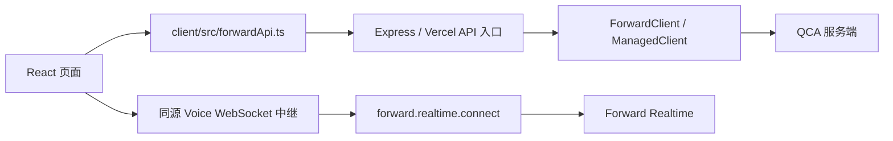

# Forward Quickstart 接入 QCA TypeScript SDK 实现方案

评估日期：2026-10-13；实施验证：2026-10-14。状态：已在 `codex/qca-sdk-migration` 实施，本地验证及中国站 SA 主要功能联调完成；Schedule 执行结果异常待排查，其他环境与在线部署待验收。详见 [测试记录](./qca-sdk-test-report.md)。

评估基线：Quickstart `main`，提交 `dc392a43b9fe5259cfa2c684338ebe97e2efceae`；SDK 使用当日 npm 最新发布包 **`qca-sdk@0.5.0`**。已下载并校验 npm 包完整性，检查包内实现和类型声明，并完成离线验证。实施时固定版本并提交根目录 lockfile，不直接依赖 GitHub `main`。版本依据：[npm 发布元数据](https://registry.npmjs.org/qca-sdk/0.5.0)、[v0.5.0 Release](https://github.com/QoderAI/qoder-cloud-agents-sdk-ts/releases/tag/v0.5.0)。

本版替代此前基于 0.4.0 的方案：Forward SA Token、Realtime REST 已有资源方法，Node 端语音 WebSocket 也已被 SDK 覆盖，不再把它们列为 SDK 能力缺口。

## 1. 可行性结论与边界

**可行。推荐在 Quickstart 的 Node 服务端接入 SDK，保留浏览器到现有代理的调用方式。**

SDK 提供 `ForwardClient` 和 `ManagedClient`，覆盖当前主要业务：Identity、Template、Session/Event、环境、模型、Skill、File、Vault/Credential、Memory、Schedule、Channel、Batch 和 Usage。客户端层次见 [ForwardClient 源码](https://github.com/QoderAI/qoder-cloud-agents-sdk-ts/blob/v0.5.0/src/forward/forwardClient.ts)。

需要区分两个完成标准：

| 完成标准 | 可行性 |
| --- | --- |
| 页面实际使用的 QCA HTTP 和上游语音 WebSocket 调用统一经过 SDK；少量 HTTP 缺口使用 SDK transport | 本次可完成，推荐采用 |
| 所有 HTTP 功能都只使用 SDK 已有资源方法，无任何 SDK request 扩展 | 仍不满足：GET /resources、只返回文件签名 URL 的形式尚需适配 |

本方案采用第一种标准：常规业务使用 SDK 资源方法；少量缺口集中使用 `client.request()`；服务端到 QCA 的语音连接改为 `forward.realtime.connect()`。浏览器到 Quickstart 的同源 WebSocket 入口继续使用 `ws.WebSocketServer`，浏览器的录音、播放和交互不需要搬进 SDK。

此次版本更新减少了自写 REST 扩展，但引入了语音协议校验和连接生命周期的适配工作。主要风险集中在语音、SSE、文件返回形式和 Usage 契约，不在普通 CRUD 方法替换。

本文保留评估时的设计依据。实现已落在 `codex/qca-sdk-migration`，实际调用边界与验证方式见 [SDK 接入说明](./qca-sdk-integration.md)。分支从 刚拉取的 `origin/main`（`dc392a4`）创建；依赖固定为 0.5.0。

## 2. 当前调用链



图中为改造后的调用链。改造前的代理使用原生 `fetch` 访问 QCA，现在由 SDK 资源方法和少量显式扩展访问。

| 位置 | 当前职责 | 改造位置 |
| --- | --- | --- |
| `client/src/forwardApi.ts` | 业务包装、请求信封、部分响应归一化、附件回退、浏览器 SSE 解析 | 保留业务入口，补齐鉴权模式传递，调整 Usage 契约 |
| `client/src/App.tsx` | 登录、事件消费、附件预览、历史分页和交互状态 | 只调整必要的参数和类型，保留事件处理逻辑 |
| `client/src/voice/voiceApi.ts` | Realtime Conversation 创建、历史查询、代理能力检查 | 经服务端映射到 SDK 原生资源方法；保留浏览器历史分页和本地 health 检查 |
| `server/src/index.ts` | Forward/Cloud JSON 代理、multipart 上传、文件预览、SSE | 将 QCA HTTP 请求替换为共享 SDK 适配层 |
| `server/src/voiceProxy.ts` | 语音鉴权、WebSocket 转发、连接关闭 | 保留本地入口和校验；替换上游为 SDK connect/sendEvent/事件迭代 |
| `api/**/*.ts` | Vercel 入口，动态导入同一个 Express app | 共用服务端 SDK 适配，不复制实现 |

注意：`listCloudModels`、`createCloudEnvironment`、`uploadCloudSkill` 等名称包含 Cloud，但多数已经调用 Forward。不能根据函数名直接改成 `ManagedClient`。真正仍依赖 Cloud 的主要是 Session resources 列表，以及 PAT 模式下历史文件的回退。

## 3. 架构选择

### 3.1 SDK 放在服务端

推荐保留这些本地协议：

- `/api/forward/request`、`/api/cloud/request`：JSON 请求信封。
- `/api/forward/upload`、`/api/cloud/upload`：浏览器 multipart 上传。
- 文件 preview 和 Session events stream 的现有路径。
- `/api/voice/socket` 和 `/api/health`。

服务端按「API 层 + HTTP method + path」选择 SDK 方法。这样可以先完成传输层替换，避免同时重写大型 `App.tsx`、页面状态和 Vercel 路由。

SDK 当前正式运行要求是 Node.js 20.12+，Realtime WebSocket 明确只支持 Node；因此统一放到现有 Node 代理最合适。Quickstart 的 Node 要求已覆盖它。0.5.0 新增运行依赖 `ws ^8.22.0`，不再是零运行依赖。Quickstart 自己仍使用 WebSocketServer，不能删除直接 `ws` 依赖；实施时检查根 lockfile 的解析结果并尽量复用兼容版本。依据：[0.5.0 package.json](https://github.com/QoderAI/qoder-cloud-agents-sdk-ts/blob/v0.5.0/package.json)。

### 3.2 SDK client 按请求创建

新增统一工厂，显式传入当前用户的 token、鉴权模式和所选环境：

```ts
import { ForwardClient, ManagedClient } from 'qca-sdk';

const auth = authMode === 'service-account'
  ? { authMode: 'sa' as const, accessToken: token }
  : { authMode: 'pat' as const, pat: token };

const forward = new ForwardClient({
  ...auth,
  baseURL: forwardBaseUrls[environment],
  timeout: 30_000,
  maxRetries: 0,
});

// 仅在确实需要 Cloud 调用时创建。
const managed = new ManagedClient({
  ...auth,
  baseURL: cloudBaseUrls[environment],
  timeout: 30_000,
  maxRetries: 0,
});
```

初次迁移设置 `maxRetries: 0`，保持当前代理单次发送的行为。后续确有需求时再启用读取重试，或对服务端支持幂等的写操作启用重试。

CN/Global 地址继续来自现有 `CN_PROD_*`、`GLOBAL_PROD_*` 配置。不得依赖 SDK 的默认 Global 地址或进程中的默认凭据。模块可以缓存无凭据的配置，不保存跨用户共享的可变 client 或 token。

### 3.3 资源方法与扩展分开

常规 route dispatcher 调用 SDK 资源方法，返回 `APIPromise` 或原始 `Response`。路径参数解码一次，由 SDK 负责编码，防止 ID 被重复编码。

缺口放在 `extensions.ts`，每个扩展记录 method、path、请求/响应类型、使用原因和对应业务。禁止把所有请求都变成无差别 `client.request()` 转发，否则只能获得 transport 的收益，仍然没有使用 SDK 的资源接口。

扩展路径采用显式列表；未匹配请求返回明确错误。当前页面必需的扩展是 GET /resources，以及 Forward/Managed 的文件签名 URL 返回形式。未调用的旧包装函数另列兼容清单，不把它们自动升级成本次页面改造的必要功能；若仍对外承诺这些导出可用，再补兼容扩展和相应验收。

## 4. 功能映射

下表为 `qca-sdk@0.5.0` 的实际接口命名。SDK 类型不会替调用方进行业务校验。

| Quickstart 功能 | SDK 调用 | 适配说明 |
| --- | --- | --- |
| 当前 SA 登录 | `forward.serviceAccountTokens.create({ saKey, … })` | 0.5.0 新增；返回完整 token/过期时间/签发元数据，SA Key 只用于这次请求 |
| Realtime Conversation 创建、历史 | `forward.realtime.conversations.create/history` | 0.5.0 新增；创建须传 idempotency_key，历史为独立分页结构 |
| 上游语音 WebSocket | `forward.realtime.connect`，连接的 `sendEvent` 和异步迭代 | 0.5.0 新增；详见第 5.7 节 |
| Identity 查询、创建、删除 | `forward.identities.list/create/retrieve/delete` | 保留 external_id 查询和 ensureIdentity 的编排 |
| Identity effective config | `forward.identities.configs.getEffective(identityId, templateId)` | 保留当前页面所需字段 |
| Template 查询、创建、更新、克隆、归档 | `forward.templates.list/create/retrieve/update/clone/archive` | 保留 model 对象、multiagent、merge patch 和 Browser Use beta header |
| Session 列表、创建、详情、归档、取消 | `forward.sessions.list/create/retrieve/archive/cancel` | 保留增量输出开关、resources、分页和当前 Identity 的客户端过滤 |
| 消息、工具确认、问题答案、自定义工具结果 | `forward.sessions.events.send(sessionId, { events })` | 保留原有各类 Event 的完整 payload |
| 历史事件和 SSE | `forward.sessions.events.list/streamEvents` | 首次迁移保留原始 SSE；见第 5.2 节 |
| 给 Session 挂载文件 | `forward.sessions.resources.add(sessionId, params)` | 保留 `/data/workspace` 下的 mount_path |
| 查询历史附件 mount_path | `managed.sessions.resources.list(sessionId)` | 当前实际使用 Cloud，Forward SDK 没有对应 list 方法 |
| 环境和模型 | `forward.environments.*`、`forward.models.list` | 环境包含 list/create/retrieve/update/archive/delete |
| Skill | `forward.skills.list/create/retrieve/update/delete` | 上传推荐 `files: [file]`；update 仍是 PUT |
| File 元数据、上传、删除 | `forward.files.list/getMetadata/upload/delete` | 方法名是 getMetadata；保留 purpose、文件名和 MIME |
| 文件二进制预览 | `forward.files.getMetadata` + `forward.files.download` | download 返回二进制 Response，不是签名 URL |
| PAT 历史文件 Cloud 回退 | `managed.files.getMetadata/delete/download` | 只在符合当前业务回退条件时使用 |
| Vault 和 Credential | `forward.vaults.list/create/retrieve/delete`；`forward.vaults.credentials.list/create/delete` | Vault update/archive 没有资源方法；页面未调用 |
| Memory entries | `forward.memoryStores.memories.list/retrieve(storeId, …)` | 保留 size/content_size_bytes 和 store_id 的归一化 |
| Schedule 和执行记录 | `forward.schedules.list/create/retrieve/update/archive/run/pause/unpause`；`forward.scheduleRuns.list/retrieve` | 删除 Schedule 没有资源方法；页面当前使用 archive |
| Channel 与扫码 | `forward.channels.list/create/retrieve/update/delete`；`forward.channels.qrSessions.create/retrieve` | 保留配对、credentials、轮询和环境差异 |
| Batch 与子任务 | `forward.batches.list/create/retrieve/cancel/getOutput/getError`；`forward.batches.tasks.list` | output/error 使用 Batch 专用接口，不能改成 Files API |
| Usage | `forward.usage.listIdentities/listTemplates` | 时间和时长字段需要专项适配 |

### 4.1 之前缺口的最新状态

此前统计的 13 个未封装 REST 操作中，0.5.0 已补上 4 个：管理员 SAT 签发、Identity SAT 签发、语音 Conversation 创建、语音历史查询。**当前页面实际使用的缺口从 4 个降到 1 个：GET /resources。**

| 原缺口 | 0.5.0 状态 | Quickstart 本次处理 |
| --- | --- | --- |
| `POST /service_account_tokens` | `forward.serviceAccountTokens.create` | 当前 SA 登录直接迁移 |
| `POST /identities/{id}/service_account_tokens` | `forward.identities.serviceAccountTokens.create` | 保留现有分支映射，页面没有调用此分支 |
| `POST /realtime/conversations` | `forward.realtime.conversations.create` | 直接迁移，映射幂等键 |
| `GET /realtime/conversations/{id}/history` | `forward.realtime.conversations.history` | 直接迁移，保留一页的 wire DTO |
| `GET /resources` | 仍无资源方法 | 当前页面确实使用，保留 SDK request 扩展 |

GET /resources 用于 Template 的资源选择，memory_store 资源目录也依赖它。不能未经验证就改为拼接 skills/files/environments/vaults/memoryStores 列表：注册资源与各实体列表不保证同一语义；尤其 memory_stores 列表还可能包含系统自动创建的默认 store。参考：[Memory Stores 列表说明](https://docs.qoder.com/cloud-agents/api/forward/memory-stores/list)。

剩余 8 个未封装操作没有当前页面调用，不作为本次迁移阻塞项：

| 旧包装的操作（相对 /api/v1/forward） | 说明 |
| --- | --- |
| `GET/POST /identities/{id}/access_tokens`、`DELETE /identities/{id}/access_tokens/{tokenId}` | 3 个操作；与新封装的 Identity service_account_tokens 不同 |
| `POST /resources/registry`、`DELETE /resources/{id}` | 2 个操作；页面只需要查询 |
| `POST /vaults/{id}`、`POST /vaults/{id}/archive` | 2 个操作；update 仅有包装测试，原注释记录过上游 501 |
| `DELETE /schedules/{id}` | 1 个操作；页面的删除交互使用已封装的 POST archive |

### 4.2 四个 SA API 均已覆盖，但并非都需要接入页面

| API | SDK 0.5.0 | 当前 Quickstart |
| --- | --- | --- |
| `POST /api/v1/serviceToken/exchange` | `ServiceAccountCredential.getToken()` | 未使用，本次不切换登录链路 |
| `POST /api/v1/forward/service_account_tokens` | `forward.serviceAccountTokens.create()` | 页面 SA 登录实际使用 |
| `POST /api/v1/forward/identities/{id}/service_account_tokens` | `forward.identities.serviceAccountTokens.create()` | 有包装分支，无页面调用 |
| `POST /api/v1/forward/service_account_tokens/{id}/revoke` | `forward.serviceAccountTokens.revoke()` | 当前代码没有调用，不顺带新增退出吊销功能 |

新增封装依据：[ServiceAccountTokens](https://github.com/QoderAI/qoder-cloud-agents-sdk-ts/blob/v0.5.0/src/forward/service-account-token.ts)、[IdentityServiceAccountTokens](https://github.com/QoderAI/qoder-cloud-agents-sdk-ts/blob/v0.5.0/src/forward/identity-service-account-token.ts)。

另外有两种情况需要区分：

- `/files/{fileId}/content` 已被 `files.download()` 覆盖，但该方法继续获取文件字节，没有只返回签名 URL 的专用方法。Quickstart 的 URL 返回接口仍需 SDK request 适配，这属于返回形式缺口，不计入上述 REST 操作缺口数量。
- Forward 没有 Session resources list 方法，但 SDK 已有 `managed.sessions.resources.list()`，能对应当前 Cloud 调用；它不是整个 SDK 的接口缺失，仍需要处理现有鉴权限制。

SDK transport 的扩展方式见 [SDK request 接口](https://github.com/QoderAI/qoder-cloud-agents-sdk-ts/blob/v0.5.0/src/core/client.ts)。

## 5. 关键问题与处理

### 5.1 PAT、SAT 与 SA Key

当前 `ForwardContext.pat` 实际上既可能是 PAT，也可能是已签发 SAT；在换 token 的那一次请求中还可能是 SA Key。服务端不能仅根据字段名判断凭据类型。

实施时在 JSON 请求信封、multipart 上传、SSE、文件 preview 和 WebSocket 的 `proxy.auth` 中补传 `authMode`，保留旧字段以兼容已有页面。已签发 SAT 用 `{ authMode: 'sa', accessToken }` 创建 SDK client，不能用 `{ authMode: 'sa', pat }`，后者会被 SDK 拒绝。旧客户端未传模式时采用兼容默认值；真实权限仍由上游验证。

本次保留当前 Forward SA token 签发接口和返回结构，改为以下 SDK 调用：

```ts
const issuer = new ForwardClient({ baseURL: forwardBaseUrls[environment], maxRetries: 0 });
const result = await issuer.serviceAccountTokens.create({
  saKey: keyFromLoginRequest,
  ...loginOptions, // 仅映射现有 ttl_seconds / metadata
});
```

SA Key 通过必填 `saKey` 参数按次传递。SDK 将其放入 Authorization，不放进 JSON body，也不留给后续业务调用；签发、Identity 签发、吊销三个方法均强制关闭自动重试。已用离线请求验证以上行为。登录后仍仅保存已签发 SAT 并清空 Key；页面依赖的过期时间及签发元数据原样返回。

官方鉴权文档明确保留 Forward token API，以满足 Forward-only、撤销和单 Identity token 等场景。依据：[官方鉴权兼容说明](https://docs.qoder.com/cloud-agents/api/conventions/authentication#compatibility-with-existing-integrations)。

SDK `ServiceAccountCredential` 使用另一条链路：通过所选区域的 OpenAPI `serviceToken/exchange`，显式申请 scopes，并在实例中缓存和续换 SAT。它的 `getToken()` 只返回 token 字符串，不能直接替代当前包含 expires_at、subject_type 等信息的登录返回对象。实现见 [ServiceAccountCredential](https://github.com/QoderAI/qoder-cloud-agents-sdk-ts/blob/v0.5.0/src/core/service-account-credential.ts)。

更关键的是，0.5.0 明确说明 Realtime SA 访问需要 Forward 签发的绑定 SAT；仅由 ServiceAccountCredential 获得的平台 SAT 不会建立该 Forward 绑定。因此不能为了使用 SDK 就改成 platform exchange。依据：[0.5.0 鉴权与 Realtime 说明](https://github.com/QoderAI/qoder-cloud-agents-sdk-ts/releases/tag/v0.5.0)。

本次不自动增加 `qca.access`，也不把现有 Forward-only SAT 当作 Cloud 凭据。当前登录后的 token 过期仍要求重新登录；SDK 使用静态 SAT 不会自动续期。若以后需要自动交换，应单独设计凭据生命周期与 Vercel 多实例下的用户会话存储。新增 revoke 封装并不要求 Quickstart 改成退出即吊销，更不能为此持久保存 SA Key。

### 5.2 SSE 和取消

推荐首次迁移这样打开上游：

```ts
const upstream = await forward.sessions.events.streamEvents(
  sessionId,
  { last_event_id: lastEventId },
  { signal: controller.signal },
).asResponse();
```

使用 SDK 打开请求，保留 SSE 原始字节、`id:`、注释心跳、增量事件和现有浏览器处理。先不启用 `resumableStream`，防止它与前端轮询、回读和断线处理叠加。

必须处理：

- `Last-Event-ID`、同一个 ID 的多个 delta、分块 UTF-8 和未知事件。
- 浏览器关闭连接时取消 SDK 请求和 reader；正常响应结束时清理监听器。
- 已发送 SSE 响应头后发生错误，按流协议或关闭连接处理，不能再返回 JSON HTTP 错误。
- 保留工具确认、requires_action、多 Agent 子线程和主 Session 的状态语义。
- 保留 no-cache/no-transform、X-Accel-Buffering 和及时刷新；同时处理下游背压。
- SDK timeout 主要约束 fetch 等待响应头；流读取需要独立的取消/期限管理，不能认为设置 30 秒就能限制整条流。

源码核查还发现当前服务端 `isTerminalSseFrame` 把 `session.thread_status_idle` 当作终止事件，而前端区分子线程和主会话。迁移前增加一个子线程完成后协调者继续输出的回归场景；若基线失败，单独定位并修复，不能仅靠 HTTP 透传测试判断 SSE 正常。

依据：[SessionEvents 接口](https://github.com/QoderAI/qoder-cloud-agents-sdk-ts/blob/v0.5.0/src/forward/session-event.ts)、[SSE 解码实现](https://github.com/QoderAI/qoder-cloud-agents-sdk-ts/blob/v0.5.0/src/core/streaming.ts)。

### 5.3 文件与 multipart

浏览器继续向本地 upload endpoint 提交 FormData。服务端 multer 得到 buffer 后，用 `toFile(buffer, originalname, { type: mimetype })` 构造 SDK 上传参数。

元数据字符串只 JSON.parse 一次，不传一个已序列化的字符串让 SDK 再包一层；不手动设置 multipart Content-Type/boundary。保留现有 12 MiB 服务端限制以及前端更小的文件限制。

聊天附件和 Batch 输入保留 `purpose: 'session_resource'`；资源管理页保留自己的 purpose。Skill 上传改用 `files: [zipFile]`，保留请求幂等键。Skill 名称和描述取自包内 SKILL.md；现有名称/描述字段在 SDK 契约中已弃用，界面说明要与实际行为一致，不能承诺输入框会覆盖包内容。依据：[Skill 接口及类型](https://github.com/QoderAI/qoder-cloud-agents-sdk-ts/blob/v0.5.0/src/forward/skill.ts)。

`files.download()` 会先取得签名链接再获取字节，返回 Response。因此：

- 对外返回签名 URL 的现有包装：使用 SDK request 调 `/content`，保持 `{ url, expires_at }`。
- 同源图片 preview：使用 SDK getMetadata/download，优先元数据 MIME，保留 inline 和 private cache 行为。
- Forward 404 后的 Cloud 文件回退只对当前允许的 PAT 场景执行；不在 401/403 时回退。预览、元数据、下载分别验证。
- 历史消息只有 mount_path 而没有 file_id 时，仍需要 Managed Session resources。现有 Forward-only SA 模式无法靠换 SDK 消除这个能力缺口，继续展示原来的附件降级状态。

SDK 下载存储请求不携带 API token、默认 headers 或 middleware。不要为了接入日志而重新把凭据加到存储请求。依据：[Files 实现](https://github.com/QoderAI/qoder-cloud-agents-sdk-ts/blob/v0.5.0/src/forward/file.ts)。

### 5.4 HTTP 返回、错误与分页

大多数代理响应建议通过 SDK 方法的 `.asResponse()` 取得 Response，再保留状态、响应体和需要的 headers。这样可保留 201、202、204，以及 SDK 某些 delete 方法在默认解析中丢弃的响应体。

发生 HTTP 错误时 SDK 仍会抛出 APIError；统一适配错误状态、code、message、request_id 和诊断片段。request ID 同时检查 x-request-id、request-id 和现有 x-trace-id 回退。连接错误可返回 502，明确的超时返回 504，调用方主动取消不弹业务错误。不能把上游 401/403/409/429 全部改成 502。

若使用解析后的 Page，只发送 `page.toJSON()` 或明确的 DTO。不要展开或序列化 client、Response、Error 的内部属性。列表继续按现有 limit/游标返回一页，不能因为 SDK 支持 async iteration 就自动拉完所有 Session、Event 或 Batch tasks。

需要保持 false、0、null 和省略字段的区别。当前代理会过滤 query 的 null/undefined/空串，SDK 的空串行为不同，需要集中归一化。已有 `types`、`incremental_streaming_enabled` 等字段不能因为没有显式类型成员就被丢弃；先通过 SDK 支持的扩展字段保留，再依据真实服务契约决定是否更新参数名称。

### 5.5 重试、幂等和 beta header

SDK 默认启用重试，与当前代理行为不同。初次改造关闭 SDK 自动重试；未来启用时，必须在同一业务操作的各次尝试中复用原来的幂等键。不能在 transport 重试时重新生成 key，也不能对写请求同时走旧代理和 SDK 两条上游路径。

Template 的 Browser Use 请求继续按 tools 内容设置 `x-qoder-beta: browser-use-2026-07-14`。SDK 不会替 Quickstart 推断工具开关。

### 5.6 Usage 是一次契约适配

现有代码使用毫秒 `start_time/end_time`、`duration_seconds`，并按当前时刻生成近 7/30 天区间。SDK Usage 类型使用整点 `start_at/end_at` 和 `active_seconds`，CN/Global 都按 Asia/Shanghai 时间解释，区间左闭右开，最长 744 小时。类型依据：[Usage 实现](https://github.com/QoderAI/qoder-cloud-agents-sdk-ts/blob/v0.5.0/src/forward/usage.ts)。

推荐一次完成以下调整：

1. 新增独立 Usage window 函数，显式使用 Asia/Shanghai。end 取当前整点，近 7/30 天分别回退 168/720 小时；本月从上海时间月初到当前整点。
2. 页面注明统计截至的整点，避免让用户误以为包含当前未完成小时。零长度区间直接显示空数据，不发送无效请求。
3. 同一次加载的 Identity aggregate、Template aggregate、Session ledger 共用一个区间；账本使用 created_at[gte] 和 created_at[lt]，避免结束边界重复。修正 usagePanel 当前初次加载、loadMore 各自调用 resolveWindow 的行为，让后续分页复用同一个 activeWindow，避免翻页时窗口漂移。
4. 更新 Usage DTO 和时长展示为 active_seconds，保留小数；单个筛选值转换为 identity_ids/template_ids 数组；缺失或 null 的 credits 仍视为不可用，不能当成零。
5. Usage 汇总必须处理全部分页，或提供明确的分页 UI；当前 `.data[0]` 和 Template 首屏汇总不能假定就是全部数据。普通历史列表仍保持单页行为。
6. 不把 Session 创建时间筛选出的账本当成计费用量的精确对账证明；跨窗口运行的 Session 仍可能与小时聚合存在口径差异。

这一调整单独提交和验收。实施时用真实环境的只读调用确认新时间参数及边界；源码核查不能证明具体部署已经采用同一版本契约。

### 5.7 实时语音：REST 和上游 WebSocket 均用 SDK

#### REST 适配

创建调用 `forward.realtime.conversations.create({ ...body, idempotency_key: envelope.idempotencyKey })`。SDK 类型要求 idempotency_key，实际发送时将其移入 Idempotency-Key header，不留在 JSON body。保留同一业务操作的 key、identity_id、template_id、title、metadata 和 config.audio.output.voice。

历史调用 `forward.realtime.conversations.history(conversationId, { limit, before, types })`。它返回专用 RealtimeHistoryPage，wire 结构是 `{ conversation, events, page: { has_more, next_before } }`，不能转换成普通 `{ data, has_more }`。代理使用 `.asResponse()` 保留原响应，或用 `page.toJSON()` 返回完整 DTO；保留 conversation.config 和未知字段，供音色恢复使用。

SDK 对 limit 校验为 1–100，types 只接受 message、work、message,work；现有 Quickstart 的 limit=100 和 types=message,work 可以对应。浏览器 getCompleteRealtimeConversationHistory 已经处理多页，服务端先保持一页返回，避免两端都自动拉全量。依据：[RealtimeConversations](https://github.com/QoderAI/qoder-cloud-agents-sdk-ts/blob/v0.5.0/src/forward/realtime/conversation.ts)。

#### WebSocket 适配

`server/src/voiceProxy.ts` 保留 WebSocketServer、Origin 检查、禁止 URL 凭据、首条 proxy.auth 校验和认证期限。原来的 `new WebSocket(upstreamUrl, …)` 改为按连接创建 SDK client 后调用 `forward.realtime.connect({ conversationId, signal, … })`。

建议采用以下单一转发策略，尽量复用浏览器协议：

1. connect 在收到并校验 voice.ready 后才返回。之后启动一个事件消费者，按 SDK 异步迭代的原始顺序向浏览器发送完整 JSON；ready 之前的 voice.state、voice.ready 自身也在队列里，不能额外合成第二个 ready。初始化状态在 connect 完成后才能转发，这是与原生透明中继的可见时序差异。
2. 浏览器发送的合法 JSON 事件用 `connection.sendEvent(event)` 转发。当前 audio.append 已经是 Base64 PCM16，不再调用会再次编码的 appendAudio；输入 16 kHz、输出 24 kHz 的录音重采样和播放继续由浏览器负责。text、interrupt、playback 回执、ping 同样保留原 payload。
3. 结束会话继续由浏览器管理：将原 connection.close（含原 request_id）经 sendEvent 发送，事件消费者转发匹配的 connection.closed；保留现有 5 秒确认期限。代理不再额外调用 SDK closeGracefully 发第二个结束请求；拿到确认后或断线清理时关闭 transport。直接 close/断网不能等同于历史已落盘。
4. 浏览器断开时立即 abort，包括 SDK 尚在等待鉴权、握手或 ready 的阶段；已建立连接也要关闭并结束消费循环。保留部署的 280 秒轮换和下游 1012 状态，让浏览器原有重连与历史恢复继续工作。
5. SDK 不自动重连、不重放输入。重连仍只由 browser voiceConnection 负责，不能在代理中增加第二套重连，避免重复文本或音频。

#### 必须处理的兼容性差异

| 差异 | 处理 |
| --- | --- |
| 更严格的服务端事件校验 | SDK 校验 version、conversation_id、event_id、递增 sequence、RFC3339 timestamp，以及 ready/audio 等 payload。现有浏览器有些异常仅忽略，而 SDK 会终止连接；真实环境必须验证，不能用改字段或伪造序号掩盖服务端不兼容 |
| 现有服务端测试报文不完整 | voiceProxy.test.ts 当前 `{ type: 'voice.ready', payload: {} }` 和任意字符串 echo 不是有效 SDK 协议。改为完整 ready、合法 audio/text 和带递增序号的服务端事件；保留 Origin、鉴权、连接释放与轮换测试 |
| SDK 默认期限与前端不一致 | SDK 默认握手 30 秒、ready 60 秒，浏览器从开始连接到 ready 共 30 秒，旧代理握手 15 秒。实现时显式设置上游期限，并由代理增加总计 30 秒的初始化 AbortController 期限；浏览器断开先到也必须取消。不能直接使用 SDK 默认值留下后台连接 |
| 收发队列与帧大小 | SDK 默认 256 条/4 MiB 队列、1 MiB 接收帧，客户端 JSON 上限 256 KiB。保留浏览器方向 4 MiB bufferedAmount 上限，检查当前音频分块，逐个处理 sendEvent 的 Promise 失败；不要在 SDK 队列外再堆积无界 Promise/消息 |
| 错误和关闭原因转换 | 握手 APIError 的 401/403/404 继续映射 4401/4403/4404；连接异常、协议错误、超时分别映射现有 UI 状态；透传合法服务端 error 与 retry_after_ms。connect 前失败若带 RealtimeServerError.event，需单独转发一次，因为尚未取得可消费连接 |
| HTTP 与 WS 是独立 transport | HTTP fetch/middleware 不能代理或 mock SDK WebSocket；WS 单独使用 transport 配置和本地 mock 上游，部署需要的 agent/TLS 配置单独验证 |

SDK 支持保留未知 Beta 事件，但已知事件的校验是硬约束。对应源码：[RealtimeConnection](https://github.com/QoderAI/qoder-cloud-agents-sdk-ts/blob/v0.5.0/src/forward/realtime/connection.ts)。

新版发布说明使用了“Realtime-enabled Template”表述，而当前 Quickstart README 说明无需额外打开 Template Realtime 开关。本次不凭发布说明新增开关或修改 Template payload；联调时以目标环境和可用模板验证创建/连接行为，若有差异再定位服务端契约。

现有 Vercel 入口和真实部署的语音验收仍需要保留。SDK 提供客户端能力，不改变托管环境的 WebSocket 限制；本地模拟通过不能代表 Vercel 在线音频已验证。

## 6. 建议文件划分

| 文件 | 职责 |
| --- | --- |
| `server/src/qca/clients.ts` | 环境、PAT/SAT 映射、client 工厂、超时和重试配置 |
| `server/src/qca/dispatch.ts` | method/path 到 Forward/Managed 资源方法的映射 |
| `server/src/qca/extensions.ts` | 缺少资源封装的 REST 接口、显式类型和路径列表 |
| `server/src/qca/http.ts` | SDK Response/错误到 Express 响应的转换 |
| `server/src/qca/transfers.ts` | multipart、预览和下载适配 |
| `server/src/qca/stream.ts` | SSE 上游打开、转发和取消 |
| `server/src/voiceProxy.ts` | SDK Realtime 上游连接、单消费者转发、错误/关闭转换、取消和队列控制；保留本地 WebSocketServer |
| `server/src/voiceProxy.test.ts`、`tests/voiceDeployment.test.ts`、`tests/voiceParity.test.ts` 及相关 fixtures | 将简化 echo 上游改成有效 Realtime 协议；覆盖 SDK 连接后本地和 Vercel 入口的一致性 |
| `server/src/index.ts` | 保留路由入口，调用上述适配层 |
| `server/package.json`、根 `package-lock.json` | 固定 qca-sdk@0.5.0，检查与现有 ws 依赖兼容 |
| `client/src/forwardApi.ts` | JSON/上传/SSE/preview 补传 authMode、Usage DTO/参数；保留业务包装和本地 fetch |
| `client/src/voice/useVoiceSession.ts`、`voiceConnection.ts` 及测试 | proxy.auth 补传 authMode、对齐错误/初始化期限；保留浏览器重连和关闭确认 |
| `client/src/voice/voiceApi.ts` 及测试 | 验证创建幂等键和历史完整 DTO，保留浏览器分页 |
| `client/src/credits.ts`、`client/src/usagePanel.tsx` | Usage 整点窗口、active_seconds 和统计范围展示 |
| `README.md`、必要的 docs | SDK 架构、已知扩展、Node 要求和验收说明 |

只在适配层使用 SDK 请求类型。页面现有 DTO、事件扩展字段和归一化逻辑逐步复用，避免一次替换所有手写类型造成大量无关修改。是否拆分 dispatch 的各个资源模块，由最终文件大小决定。

## 7. 实施顺序与交付

### 阶段一：基线、SDK 适配层和 REST

- 先运行现有 client/server/deployment 测试和构建，记录已有失败。
- 固定 qca-sdk@0.5.0，新增 client 工厂、HTTP 适配、资源映射和扩展清单。
- 补传 authMode，迁移当前 SA 登录及常规业务资源请求。
- Realtime 创建/历史直接使用 SDK 原生方法；GET /resources 保留受控 request 扩展。
- 验证浏览器请求信封、上游 payload、错误码、beta header 和幂等键。

交付：常规 JSON 功能由 SDK 调用，页面行为与原先一致。

### 阶段二：文件和 SSE

- 迁移 multipart、签名链接、二进制 preview、PAT Cloud 回退和 Session resources list。
- 迁移 SSE 打开方式；保留字节转发并实现完整取消。
- 覆盖工具交互、多 Agent、附件历史、断线和异常流。

交付：聊天、附件、流式输出和历史行为完成对照验证。

### 阶段三：语音上游 WebSocket

- 替换原生上游 ws client 为 forward.realtime.connect，保留本地 WebSocketServer。
- 实现单消费者、sendEvent、超时取消、错误映射和部署轮换；保留浏览器的重连、录音播放及关闭确认。
- 更新有效协议测试夹具，覆盖初始化前断开、预 ready 事件、未知事件、语音收发、重连回读和结束落盘。

交付：语音 REST 和上游 WebSocket 全部由 SDK 访问 QCA。

### 阶段四：Usage 契约适配

- 完成小时窗口、稳定分页窗口、筛选数组、分页汇总和 active_seconds 字段适配。
- 验证时区、月初、空区间、缺失 credits 和浮点时长。
- 用目标环境的只读调用核验实际服务契约，保留统计截至整点的页面说明。

交付：Usage 页面与 SDK 契约一致。此阶段与语音可分别提交和回归。

### 阶段五：联调、文档和验收

- 本地 Express 和 Vercel 导出入口使用同一 mock 上游进行对照。
- 在有可用凭据和测试资源时执行真实 CN/Global、PAT/SA 验收；对不存在的组合标记未验证。
- 检查页面实际调用路径中面向 QCA 的原生 HTTP fetch、上游 new WebSocket 已替换；extensions 仅包含列明缺口。浏览器本地 fetch、WebSocket 及服务端 WebSocketServer 仍然需要。
- 补充最小 SDK 使用示例，让读者能看到资源方法如何调用；不要只有 dispatcher 实现可供学习。

建议按上述边界拆分提交。回滚使用 Git revert 对应迁移提交，并恢复依赖锁定；不保留两套长期并存的业务客户端，也不做写请求的双路验证。

## 8. 验证矩阵与完成标准

| 范围 | 必须覆盖 |
| --- | --- |
| 环境与凭据 | CN/Global 路由；PAT/SAT 模式；两个用户同时请求互不混用 token；旧信封兼容 |
| SA 登录 | 使用 Forward SAT；saKey 不入 body、不污染业务请求；返回完整签发信息；SDK 不自动重试；不新增 Key 持久化 |
| JSON 与错误 | 201/202/204；未知响应字段；401/403/404/409/429；非 JSON 错误；request ID；超时与取消 |
| 写入 | 同一操作复用幂等键；初始 maxRetries=0；null 清空、false 和空数组；Browser Use beta header |
| 列表 | Session/Event/Batch 游标、顺序、单页行为；Usage 多页汇总；query 数组编码 |
| SSE | 首段即显示；重复 ID 的 delta；分块 UTF-8；恢复游标；子线程结束后继续主会话；用户交互；浏览器断开 |
| 文件 | JSON metadata、purpose、ZIP files 字段、文件名/MIME、签名 URL 与字节响应区分、204 删除、PAT 404 回退、SA 降级 |
| Usage | 上海时区、整点、月初、744 小时上限、相同查询范围、小数时长、缺失 credits |
| 语音 REST | 创建幂等键进入 header；config 音色；专用历史页结构和 before；未知字段；浏览器多页恢复 |
| 语音连接 | 完整 ready、预 ready/未知事件、文本/PCM16/Work/播放回执/interrupt；单消费者；原关闭 request_id 和 ack；初始化取消；队列溢出；错误码；仅浏览器重连；280 秒轮换 |
| 部署 | 本地/Vercel 入口一致；ws 依赖能打包；真实目标环境的握手、音频、结束落盘单独验收 |

实施阶段执行：

```bash
npm run test --workspace=client
npm run test --workspace=server
npm run build --workspace=client
npm run build --workspace=server
npm run test:deployment
```

新增测试集中在真实请求/响应边界，使用 SDK 的可注入 fetch 或本地模拟 QCA 上游。不只 mock 资源方法返回固定对象，否则无法发现 multipart、query 编码和状态丢失问题。

完成标准：页面实际使用的 QCA HTTP 和上游语音 WebSocket 功能全部经过 SDK；已封装能力全部使用资源方法；扩展接口明确可数；PAT/SA、CN/Global、本地/Vercel 的可用组合验证通过；未提供凭据的真实环境验收明确记录。未使用的 8 个旧包装不计入页面功能完成范围，若要求保留其可调用契约，则单独列兼容扩展和验收结果。

## 9. 实施前的 SDK 评估记录

在独立临时目录使用实际 `qca-sdk@0.5.0` 发布包、`ws@8.22.0` 和 Node.js 22.22.2，执行了 **17 项离线检查，全部通过**。没有向 Quickstart 安装依赖或修改其业务实现。

先在新版本上复跑原有 8 项检查：

1. 资源方法保留 HTTP status、request ID、SAT、幂等键及额外字段。
2. Page 可转成普通 DTO，Forward query 数组采用重复参数。
3. SDK SSE 不丢弃相同 ID 的多个 delta，能传递恢复游标。
4. Skill 可按推荐 files 字段上传 ZIP。
5. files.download 返回二进制 Response，存储请求不携带 API headers。
6. delete 方法的 asResponse 可保留默认 void 解析会丢弃的响应体。
7. Managed SDK 提供当前附件回溯所需的 Session resources list。
8. 自动 SA credential 使用新的 OpenAPI 交换地址和 scopes 请求。

再针对新能力增加 9 项检查：

1. 三个 Forward SA 方法的 Key 按次覆盖、Key 不入 body、签发元数据保留、后续普通 PAT 不被污染；有显式 Key 时不调用普通 credential provider。
2. 三个 SA 方法在 client/request 都指定重试时仍各只发送一次。
3. Realtime create 将幂等键移至 header，保留音色 config 和 201 状态。
4. Realtime history 的 toJSON 保留 config 和未知字段，下一页正确传 before 和 types。
5. GET /resources 和文件签名 URL 可用 SDK request 保持契约；签名 URL 请求不会提前下载文件。
6. 本地模拟 WS 验证 SAT header、connect 后预 ready/ready/未知事件队列、Base64 不重复编码，以及原 request_id 的关闭确认仅发送一次。
7. 证实现有简化 ready 测试夹具会触发 SDK 协议错误，需要更新。
8. 等待 ready 时 AbortSignal 能取消并释放已建立的 transport。
9. WS 握手 401 保留 HTTP 状态，代理可以继续映射原关闭码。

评估脚本暂存于 `/tmp/forward-qca-sdk-0.5.0-review/probe-existing.mjs` 和 `probe-new.mjs`，没有作为项目测试提交。实施时把关键场景落成仓库内的回归测试。

以上为实施前的探针记录，仅验证 SDK 行为。实施后又增加了仓库内的 HTTP/SSE、语音生命周期、Usage 和上传/预览回归，详见接入说明。真实 QCA、存储、SA 端点和 Vercel 在线环境仍未验证。
